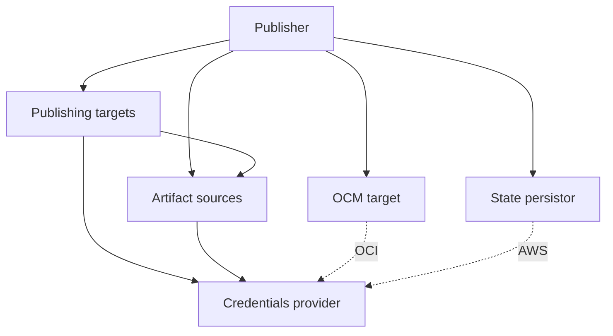

# GLCI

GLCI publishes Garden Linux images to cloud providers and OCI registries. It records the resulting image references in the build manifests and produces an Open Component Model (OCM) component descriptor for Gardener.

GLCI is configured through YAML. The configuration selects the build flavors, artifact sources, publishing targets, credentials, and state storage for a deployment. Building Garden Linux itself is outside the scope of this guide.

Start with [Concepts](#concepts), [Setup](#setup), and [Operations](#operations). Use [Recovery](#recovery) when a run fails and the [Reference](#reference) for configuration details.

## Concepts

| Term | Meaning |
| --- | --- |
| Flavor | A named build variant, such as `aws-gardener_prod-amd64` or `container-arm64`. |
| Platform | The build platform recorded in a manifest, such as `aws` or `container`. It must match the first part of the flavor name. |
| Manifest | A build's metadata and artifact list. GLCI also records published image metadata in it. |
| Artifact source | A location from which GLCI reads build artifacts or manifests, and to which GLCI writes modified manifests. |
| Publishing target | A destination where Garden Linux images are published, such as a cloud account or an OCI repository. |
| Published image metadata | Information identifying the published images and where to find them, such as image IDs, regions, repository references, or digests. GLCI records it in manifests for later use, including deciding whether work is already complete. |
| Publishing group | One or more flavors published together as a single result, with shared published image metadata. |
| Component descriptor | A release description intended for consumption by Gardener. It contains published image metadata references, build information, and package metadata. |
| State | Records of resources created during unfinished work. GLCI uses them to clean up that work before retrying after an interruption or failure. |

## Setup

### Prepare artifact sources

GLCI needs the artifacts and manifests for the Garden Linux flavors you want to publish.

**Limitation.** Currently, the only supported artifact source is Amazon S3.

For your own builds, use the Garden Linux build system and store its artifacts and manifests in your S3 bucket. Keep artifact object keys consistent with those recorded in the manifests. The [artifact source reference](#artifact-source-reference) describes the required layout.

**Limitation.** Official manifests may already contain published image metadata, which GLCI can interpret as work already completed. Pointing the manifest source at upstream and selecting a separate manifest destination does not reset that metadata. The manifest source must contain your own copies, derived by scrubbing published image metadata from the upstream manifests. GLCI does not provide a command to perform that preparation.

For unmodified upstream Garden Linux, publishing targets can read the image artifacts directly from the public `gardenlinux-github-releases` bucket. Obtain the upstream manifests, modify them to an unpublished state, and store the modified manifests in your own bucket before running GLCI. Use your bucket as the manifest source and the official bucket as the publishing targets' artifact source.

GLCI writes published image metadata back to the manifests. By default, it updates them in the same bucket from which it reads them. You can configure a separate writable manifest destination if you want to keep subsequent updates apart from the prepared input manifests. The [configuration template](glci_template.yaml) reads and updates your private manifests while reading the image artifacts upstream.

**Limitation.** GLCI requires AWS credentials even for public artifact sources. You can use credentials from your own AWS account, provided the IAM identity is allowed to read the public upstream objects.

### Prepare publishing targets

GLCI supports AWS, Azure, GCP, Aliyun, OpenStack, Container, and RBSC (OCI) publishing targets. Each needs its own destination infrastructure, permissions, and configuration. Prepare the ones you intend to use according to the [publishing target reference](#publishing-target-reference).

GLCI creates images within that infrastructure. It does not create your cloud accounts, enable services, or provision the required buckets and galleries.

### Choose state storage

State is required for GLCI to recover correctly after a failed or interrupted run. Keep it available to subsequent runs.

`File` is a good choice for local use or persistent runners. It stores state in the working directory, which must survive between runs. For CI with disposable runners, use the S3 implementation, configured as `AWS`, or explicitly preserve and restore the state file. Do not discard the state file as ordinary temporary output.

See the [state storage reference](#state-storage-reference) for the configuration and storage requirements.

### Choose component descriptor output

Gardener typically consumes component descriptors from an OCI registry, so use `OCI` for that workflow. Use `File` to process the descriptor with other tooling or to ignore its output if you do not intend to use Gardener and do not need a descriptor.

**Limitation.** A component descriptor output must still be configured even when you do not use it. Choosing `File` and ignoring the resulting file is sufficient.

See the [component descriptor reference](#component-descriptor-reference) for output fields and the information included.

### Connect Vault

**Limitation.** Vault is currently the only supported credential provider.

Configure its server and, if applicable, namespace. Supply a token, token file, AppRole credentials, or JWT login. Configure only the intended login method, since the first complete method takes precedence.

The `config` value on an artifact source, publishing target, or other credential consumer selects a credential set in Vault. It is not a configuration filename or cloud account ID. The mapping from this name to a Vault path depends on the publishing target.

**Limitation.** The mapping between config strings and Vault paths is currently not configurable, and is hardcoded in GLCI (see `vault.go`). Your Vault layout must follow them.

Provision the required engines, roles, records, and access policies using the [credential provider reference](#credential-provider-reference). See [Credential lifetime](#credential-lifetime) for renewal and rotation behavior.

### Create the configuration

Start from the annotated [configuration template](glci_template.yaml). Keep the flavors and publishing targets you need, replace the deployment placeholders, and complete the manifest preparation described above. The [configuration reference](#configuration-reference) explains how the sections and references fit together.

GLCI maps configuration keys to environment variables using the `GLCI_` prefix, uppercase letters, and underscores in place of dots and hyphens. This lets a workflow supply credentials and override settings without rewriting YAML.

| Setting | Environment variable | Example use |
| --- | --- | --- |
| `debug` | `GLCI_DEBUG` | Set to `true` to enable debug logs. |
| `config-file` | `GLCI_CONFIG_FILE` | Select a deployment's YAML file. |
| `publishing.credentials.jwt` | `GLCI_PUBLISHING_CREDENTIALS_JWT` | Supply the workflow's signed JWT for Vault login. |
| `publishing.manifest_target` | `GLCI_PUBLISHING_MANIFEST_TARGET` | Select the ID of an already configured writable artifact source. |
| `publishing.ocm.file` | `GLCI_PUBLISHING_OCM_FILE` | Choose the descriptor output path when using `File`. |

**Limitation.** Environment overrides for nested settings require the corresponding key to exist in YAML, even with an empty value. Individual list entries cannot be overridden through environment variables.

An explicitly supplied command-line flag takes precedence over its environment variable. Environment values take precedence over YAML, which takes precedence over flag defaults.

## Operations

This section describes GLCI's four top level commands and how they behave when repeated or interrupted.

Every operation takes a release version and build commit. Use the full commit recorded in the manifests or its first eight characters. GLCI does not resolve branch names or Git tags.

| Command | Effect |
| --- | --- |
| `publish` | Publishes the configured images, records their published image metadata, and writes the component descriptor unless omitted. |
| `unpublish` | Removes published images that support unpublishing and clears their published image metadata. |
| `replicate` | Copies artifacts between configured artifact sources as required by the publishing targets. Currently intended for China publishing paths. |
| `unreplicate` | Removes the replicated artifacts. |

### Publish and unpublish

`publish` skips flavors already recorded as published. A publishing group is complete when its group manifest records all members. GLCI uses these records to decide what remains to do, rather than checking every remote image on each run.

Most flavors can be unpublished, or in other words publishing them is reversible. Exceptions include flavors pushed to OCI repositories which do not support deleting existing tags. In such cases, publishing those flavors is irreversible. The OCM component descriptor is always considered irreversible, since it signifies the completion of publishing and is used as a release gate.

GLCI publishes reversible flavors first, then irreversible flavors, and finally writes the component descriptor. Use `--omit-irreversible` to run only the reversible part. This also omits the descriptor. `--omit-component-descriptor` omits only the descriptor.

After an interrupted or failed publish, rerun with the same release version and commit, and the same configuration. GLCI first rolls back unfinished work, then starts that work again. Completed flavors remain published and are skipped. See [Recovery](#recovery) for persistence failures and other cases that need intervention.

`unpublish` skips flavors already recorded as unpublished and those that cannot be reversed. After a partial unpublish, rerun with the same release version and commit, and the same configuration. If some resources were removed before their manifest could be updated, normal consistency checks can stop the retry. `--steamroll` permits supported cleanup of such partial results.

In other words, publishing is always idempotent, while unpublishing is idempotent when used with `--steamroll`.

Examples, with `RELEASE_VERSION` and `BUILD_COMMIT` supplied by your workflow:

```sh
# Publish the reversible part of a release.
glci --config-file glci.yaml publish \
  --version "$RELEASE_VERSION" --commit "$BUILD_COMMIT" \
  --omit-irreversible

# Publish the remaining work and write the descriptor.
glci --config-file glci.yaml publish \
  --version "$RELEASE_VERSION" --commit "$BUILD_COMMIT"

# Retry cleanup after a partial unpublish.
glci --config-file glci.yaml unpublish \
  --version "$RELEASE_VERSION" --commit "$BUILD_COMMIT" \
  --steamroll
```

### Replicate and unreplicate

Certain flavors need to be published from copies of the images located on a different source. For example, publishing to regions in China requires an artifact source also located there. To support this GLCI can automatically replicate artifacts from the original artifact source to a secondary one, only for those flavors that need the secondary source. It can also unreplicate or remove those copies.

The publishing targets determine which artifacts need replication and which artifact sources receive them. Replication is idempotent, with partial interrupted uploads resumed. Checksums ensure that the result is always correct. Unreplication, like unpublishing, is idempotent when used with `--steamroll`.

Example:

```sh
# Replicate artifacts before a later publishing run.
glci --config-file glci.yaml replicate \
  --version "$RELEASE_VERSION" --commit "$BUILD_COMMIT"
```

### Combine the operations

For convenience, `publish` supports `--replicate` and `--unreplicate` flags that run the corresponding operations before and after publishing, respectively. Both flags can be used together.

Example:

```sh
glci --config-file glci.yaml publish \
  --version "$RELEASE_VERSION" --commit "$BUILD_COMMIT" \
  --replicate --unreplicate
```

Each stage must succeed before the next can begin.

## Inner workings

### Routing and groups

Each flavor must match exactly one publishing target. Cloud publishing targets and Container select by the manifest's `platform`, which must agree with the flavor name. RBSC selects by whether the manifest's publishing group names one of its configured repositories.

A publishing group combines one or more flavors into a single published result. Each group uses one publishing target and destination. The target must support grouping and defines how the members' results are combined. Two groups in the same publishing target must use distinct destinations.

Configured group names must agree with any already recorded in the manifests.

### Dependencies and order

GLCI is internally organized in modules, which start in dependency order and stop in reverse dependency order. The following diagram shows those relationships.



A publish run first recovers tracked work, reads and validates manifests, and prepares the component descriptor. It then follows the reversible, irreversible, and descriptor order described in [Operations](#operations). A group's results are combined after all its members have been published. Independent tasks run concurrently. When one fails, dependent tasks are skipped while unrelated work may still finish.

### Manifest reads and writes

The build manifest supplies artifact keys, platform, architecture, and build metadata. GLCI records results in `published_image_metadata`. Group members also retain their individual results in `individual_published_image_metadata`. Writes stamp `glci_version` and include the resolved flavor and publishing group.

A group's manifest is stored under `meta/singles/<group>-<version>-<commit8>`. Its member list records that the group has been published. Unpublish clears published image metadata and empties that list. It retains the manifests themselves.

With a separate `manifest_target`, GLCI still requires the original source manifest. If a corresponding destination manifest exists, GLCI validates its release identity and uses that copy, including its published image metadata. Otherwise it uses the original. A separate destination therefore does not reset the publishing status recorded in the input manifests.

## Recovery

After a failed or interrupted publish, rerun with the same version, commit, state storage, and identical configuration. GLCI first rolls back tracked work, then skips completed flavors and attempts the remaining work. There is no separate resume command. An unpublish run also begins by rolling back tracked work. Preserve the state between runs of the same release version and commit.

**Limitation.** State storage does not provide a lock between GLCI processes. Keep runs for the same release and destinations serialized in your workflow. **Multiple instances of GLCI operating on the same version and commit at the same time will result in undefined behavior, and almost certainly incorrect results.**

Replication has its own mechanism for resuming transfers, independent of publishing state.

Most errors indicate either a configuration problem or a transient error. The latter can usually be resolved by rerunning GLCI. Whenever GLCI encounters an error, it logs it and continues all independent operations already running in parallel. Only when all operations have completed, successfully or not, does GLCI exit with the respective exit status.

In rare circumstances GLCI may encounter a critical error. Cloud resources, manifests, and recovery state are separate writes, not one transaction. An error while persisting state or manifests is considered critical and requires manual intervention. When GLCI detects a critical error, it will log a prominent error banner. In this case preserve the state and logs, and compare the recorded resources with the provider before any further action.

### Retries and timeouts

GLCI retries all requests with backoff and applies timeouts appropriate to every operation.

**Limitation.** The retry and timeout settings are hardcoded and not configurable.

### Credential lifetime

GLCI manages leased credentials and renews Vault login tokens, subject to Vault's maximum TTL limits. It attempts to revoke all secrets on shutdown, except Vault login tokens supplied directly or through a file.

**Limitation.** Tokens supplied directly or through a file are not renewed, even if Vault allows renewal. If using that authentication method, supply a token whose remaining lifetime covers the job.

## Reference

### Configuration reference

The annotated [configuration template](glci_template.yaml) provides a complete example to adapt. The tables below cover the shared settings. Implementation-specific fields are described in the corresponding reference sections.

Unless a different default is documented, omitted configuration values use their type's zero value. This means `false` for booleans, `0` for numbers, `""` for strings, and empty lists or maps. Required fields still need values. Some empty values have specific behavior, such as `manifest_target` falling back to `manifest_source`.

See [Create the configuration](#create-the-configuration) for environment overrides and precedence. Defaults apply when no configuration value or override is supplied.

#### Configuration sections

`flavors` and `publishing` are top level keys. Each entry in `publishing.sources` and `publishing.targets` configures one implementation. Implementation names are case sensitive.

| Key | Type | Requirement or default | Description |
| --- | --- | --- | --- |
| `flavors` | List of mappings | Required | Build flavors to operate on. See [Flavors](#flavors). |
| `publishing` | Mapping | Required | Contains the publishing configuration below. |
| `publishing.credentials` | Mapping | Required | Credential provider configuration. `source` selects the credential provider type. See [Credential provider reference](#credential-provider-reference). |
| `publishing.sources` | List of mappings | Required, at least one | Artifact sources for manifests, image artifacts, or replicas. Each entry uses `source` to select the artifact source type. See [Artifact source reference](#artifact-source-reference). |
| `publishing.manifest_source` | String | Required | ID of the artifact source containing the input manifests. |
| `publishing.manifest_target` | String | `""`, uses `manifest_source` | ID of the artifact source receiving updated manifests. |
| `publishing.targets` | List of mappings | Required, at least one | Publishing destinations. Each entry uses `target` to select the publishing target type. See [Publishing target reference](#publishing-target-reference). |
| `publishing.state` | Mapping | Required | Recovery state storage. `backend` selects the state storage type. See [State storage reference](#state-storage-reference). |
| `publishing.ocm` | Mapping | Required | Component descriptor output. `target` selects the output type. See [Component descriptor reference](#component-descriptor-reference). |

#### Flavors

Each entry in `flavors` has the following fields.

| Key | Type | Requirement or default | Description |
| --- | --- | --- | --- |
| `flavor` | String | Required | Exact build flavor name used to locate its manifest. |
| `publishing_group` | String | `""`, no group. Required by some publishing targets. | Name of the group in which to publish this flavor. It must agree with any group already recorded in the manifest. |
| `in_component_descriptor` | Boolean | `false` | Include this flavor in the component descriptor. |

#### Source references and credential names

IDs connect the configuration sections.

| Key or field | Type | Requirement or default | Description |
| --- | --- | --- | --- |
| `publishing.sources[].id` | String | Required for a referenced source | ID used to refer to this source. IDs must be unique within the configuration. |
| `publishing.targets[].source` | String | Required | ID of the artifact source supplying that target's image artifacts. |
| `source_china` on targets that support it | String | `""`, uses the target's `source` | ID of an alternative artifact source for China publishing. |
| `config` on a credential consumer | String | Required where documented for that implementation | Name of a credential set supplied by the credential provider. |

For example, the template's manifest settings refer to `example_manifests`, while its publishing targets refer to `gardenlinux_upstream`. Every artifact source reference must resolve to a configured source. See [Credential provider reference](#credential-provider-reference) for how credential names are resolved.

### CLI reference

The four operational commands are `publish`, `unpublish`, `replicate`, and `unreplicate`. Each requires a release version and build commit. The defaults below apply when no flag, environment variable, or configuration value overrides them.

| Applies to | Option | Default | Description |
| --- | --- | --- | --- |
| All operational commands | `--version`, `-v` | `""`, required | Release version. |
| All operational commands | `--commit`, `-c` | `""`, required | Full build commit or its first eight characters. |
| All commands | `--config-file` | `""`, automatic discovery | Configuration file path. Defaults to a file in the working directory named `glci` with a supported extension, e.g. `glci.yaml`. |
| All commands | `--debug` | `false` | Enable debug logging. |
| All commands | `--glacial` | `false` | Serialize task dispatch. Useful for debugging, glacially slow. |
| `publish` | `--replicate` | `false` | Replicate required artifacts first. |
| `publish` | `--unreplicate` | `false` | Remove replicas after successful publishing. |
| `publish` | `--omit-irreversible` | `false` | Omit irreversible flavors. Implies `--omit-component-descriptor`. |
| `publish` | `--omit-component-descriptor` | `false` | Omit the component descriptor. |
| `unpublish`, `unreplicate` | `--steamroll` | `false` | Ignore missing resources when cleaning up. For `unreplicate`, also delete destination objects that do not match the source. |
| Root command | `--version`, `-v` | `false` | Report the GLCI version. |
| All commands | `--help`, `-h` | `false` | Display command help. |

`glci help <command>` displays that command's help.

### Artifact source reference

Flavor manifests use the following object key within the manifest source:

```text
meta/singles/<flavor>-<version>-<commit8>
```

`commit8` is the first eight characters of the build commit. Artifact object keys come from `paths[].s3_key` in the manifest and are resolved within the publishing target's artifact source.

See [Prepare artifact sources](#prepare-artifact-sources) for preparing manifests when using upstream images, and [Component descriptor reference](#component-descriptor-reference) for package list requirements.

#### AWS S3

Use `source: AWS`.

| Key | Type | Requirement or default | Description |
| --- | --- | --- | --- |
| `config` | String | Required | Credential set for access to the S3 bucket. |
| `region` | String | Required | AWS region containing the bucket. |
| `bucket` | String | Required | S3 bucket name. |

Grant access according to how the bucket is used.

| Use | Required S3 access |
| --- | --- |
| Input artifacts and manifests | Read the required objects. |
| Manifest destination | Read existing manifests and write updated manifests. |
| Replication destination | Read object properties, upload and delete objects, and list, upload, complete, and abort multipart uploads. |

Cloud importers that fetch artifacts by URL must be able to reach the signed URLs. The bucket need not be public.

### Publishing target reference

#### AWS

Use `target: AWS`.

| Key | Type | Requirement or default | Description |
| --- | --- | --- | --- |
| `source` | String | Required | Artifact source ID for the image artifacts. |
| `config` | String | Required | Credential set for EC2 image operations. |
| `region` | String | Required | Initial import and AMI registration region. |
| `regions` | List of strings | Empty, all available regions | Regions in which to publish AMIs. An explicit list must include `region`. |
| `image_tags` | Mapping | Empty | Tags applied to AMIs, configured by the fields below. |
| `source_china` | String | `""`, uses `source` | Artifact source ID for China publishing. |
| `config_china` | String | `""`, China publishing disabled | Credential set for EC2 image operations in China. |
| `region_china` | String | Required when `config_china` is set | Initial import and AMI registration region in China. |
| `regions_china` | List of strings | Empty, all available China regions | China regions in which to publish AMIs. An explicit list must include `region_china`. |

Fields within `image_tags`:

| Key | Type | Requirement or default | Description |
| --- | --- | --- | --- |
| `include_gardenlinux_version` | Boolean | `false` | Add a `gardenlinux-version` tag containing the release version. |
| `include_gardenlinux_committish` | Boolean | `false` | Add a `gardenlinux-committish` tag containing the build commit. |
| `static_tags` | Mapping of strings to strings | Empty | Fixed tag names and values. |

Prepare enabled destination regions and VM Import/Export authorization, including the default `vmimport` service role with access to the source bucket. The publishing credentials also need image creation, copying, public sharing, and cleanup permissions.

GLCI publishes public EC2 AMIs in the selected regions. Unpublish deregisters the AMIs and removes their associated snapshots.

Secure Boot flavors are not published to China.

#### Azure

Use `target: Azure`.

| Key | Type | Requirement or default | Description |
| --- | --- | --- | --- |
| `source` | String | Required | Artifact source ID for the image artifacts. |
| `config` | String | Required | Credential set for image operations and staging storage. |
| `storage_container` | String | Required | Blob container used to stage image artifacts. |
| `resource_group` | String | Required | Resource group containing the gallery and managed images. |
| `gallery` | String | Required | Community gallery name. |
| `region` | String | Required | Image creation location. |
| `regions` | List of strings | Empty, all available regions | Gallery replication regions. An explicit list must include `region`. |
| `image_prefix` | String | Required | Prefix used to construct gallery image definition names. |
| `image_description` | String | Required | Image description. |
| `image_eula` | String | Required | Image EULA URL. |
| `image_release_note` | String | Required | Image release note URL. |
| `image_publisher` | String | Required | Gallery image publisher identifier. |
| `image_offer` | String | Required | Gallery image offer identifier. |
| `image_sku_prefix` | String | Required | Prefix used to construct the image SKU. |
| `source_china` | String | `""`, uses `source` | Artifact source ID for China publishing. |
| `config_china` | String | `""`, China publishing disabled | Credential set for image operations and staging storage in Azure China. |
| `region_china` | String | Required when `config_china` is set | Image creation location in China. |
| `regions_china` | List of strings | Empty, all available China regions | Gallery replication regions in China. An explicit list must include `region_china`. |

Prepare a resource group, a community gallery in the creation region, and a storage account with the configured blob container. Grant access for image creation, gallery updates, blob staging, and cleanup.

GLCI publishes image versions in the configured community gallery and replicates them to the selected regions. Unpublish removes the versions, their managed images, and empty image definitions.

#### GCP

Use `target: GCP`.

| Key | Type | Requirement or default | Description |
| --- | --- | --- | --- |
| `source` | String | Required | Artifact source ID for the image artifacts. |
| `config` | String | Required | Credential set for image and storage operations. |
| `project` | String | Required | Destination GCP project ID. |
| `bucket` | String | Required | Cloud Storage bucket used to stage image artifacts. |

Prepare a project and a Cloud Storage staging bucket. Grant access for image operations, public sharing, bucket staging, cleanup, and signed URL generation with the configured service account.

GLCI publishes images in the configured GCP project and lets anyone authenticated with a Google account or service account use them to create VMs. Unpublish deletes the images.

#### Aliyun

Use `target: Aliyun`.

| Key | Type | Requirement or default | Description |
| --- | --- | --- | --- |
| `source` | String | Required | Artifact source ID for the image artifacts. |
| `config` | String | Required | Credential set for ECS image and OSS storage operations. |
| `region` | String | Required | Initial image import region. |
| `regions` | List of strings | Empty, all available regions | Regions in which to publish images. An explicit list must include `region`. |
| `bucket` | String | Required | OSS staging bucket in the import region. |

Prepare an OSS staging bucket in the import region and ECS image import authorization, including access to OSS through `AliyunECSImageImportDefaultRole`. Grant access for import, region copies, public sharing, staging, and cleanup.

GLCI publishes public ECS images in the selected regions. Unpublish deletes the images.

#### OpenStack

Use `target: OpenStack`.

| Key | Type | Requirement or default | Description |
| --- | --- | --- | --- |
| `source` | String | Required | Artifact source ID for the image artifacts. |
| `configs` | List of mappings | Required, at least one | Credential sets and the regions served by each, configured below. |
| `source_china` | String | `""`, uses `source` | Artifact source ID for regions whose names begin with `ap-cn-`. |
| `test` | Boolean | `false` | Add `-test` to the flavor portion of image names. |

Fields within each `configs` entry:

| Key | Type | Requirement or default | Description |
| --- | --- | --- | --- |
| `config` | String | Required | Credential set for the listed regions. |
| `domain` | String | Required | Qualifier used with each region to select credentials. It does not set the Keystone authentication scope. |
| `regions` | List of strings | Required, at least one | Regions whose Glance service endpoints receive images. |

Config names and region names must be unique across the publishing target. See [Credential provider reference](#credential-provider-reference) for credential lookup details.

Prepare the projects and regions where images will be created. Each region needs a Glance endpoint in the service catalog and `web-download` image import enabled so it can fetch the artifact URL.

GLCI publishes Glance images in every configured region. VMware images use public visibility, and metal images use community visibility. Unpublish deletes the images.

GLCI authenticates through OpenStack application credentials.

#### Container

Use `target: Container`.

| Key | Type | Requirement or default | Description |
| --- | --- | --- | --- |
| `source` | String | Required | Artifact source ID for the image artifacts. |
| `repositories` | Mapping | Required, at least one | Publishing destinations configured under [OCI repositories](#oci-repositories). |

GLCI publishes container images to the configured repositories. It combines each publishing group's images into an OCI image index tagged with the release version, supporting images with multiple architectures.

#### RBSC

Use `target: RBSC`.

| Key | Type | Requirement or default | Description |
| --- | --- | --- | --- |
| `source` | String | Required | Artifact source ID for the image artifacts. |
| `repositories` | Mapping | Required, at least one | Publishing destinations configured under [OCI repositories](#oci-repositories). |

GLCI packages each flavor's build artifacts as an OCI artifact and publishes it to the configured repository. It combines each publishing group's artifacts into an OCI image index tagged with the release version.

#### OCI repositories

OCI-based targets use a `repositories` mapping keyed by publishing group name. Every flavor published by such a target must belong to a group listed in that target's mapping. Each entry contains the following fields.

| Key | Type | Requirement or default | Description |
| --- | --- | --- | --- |
| `repository` | String | Required | Destination OCI registry repository. Must be unique within the publishing target. |
| `config` | String | Required | Credential set for repository access. |
| `allows_delete` | Boolean | `false` | Declare that the repository supports deletion. False makes publishing to it irreversible. |

Grant push access to each repository. Unpublishing also requires deletion support and permissions, as described in [OCI deletion behavior](#oci-deletion-behavior).

#### OCI deletion behavior

GLCI normally deletes the image index referenced by the publishing group's tag. It does not explicitly delete child manifests or image configuration and layer blobs. Further cleanup depends on the registry's retention and garbage collection policies.

For `ghcr.io`, GLCI explicitly deletes the GitHub package versions corresponding to the image index and its child manifests. The credential's `password` must be a token that supports both registry authentication and the required GitHub package API operations.

**Limitation.** GLCI's GHCR cleanup currently supports organization-owned packages only.

### State storage reference

#### File state

Use `backend: File`. There are no additional fields.

State files are named `state_<version>-<commit8>.json` and written to the working directory. Preserve them between runs.

#### AWS S3 state

Use `backend: AWS`.

| Key | Type | Requirement or default | Description |
| --- | --- | --- | --- |
| `config` | String | Required | Credential set for access to the state bucket. |
| `region` | String | Required | AWS region containing the bucket. |
| `bucket` | String | Required | S3 bucket holding the state records. |

State objects are named `state_<version>-<commit8>.json` and stored at the bucket's root. Grant read, write, and delete access.

### Component descriptor reference

GLCI creates an OCM v2 descriptor containing image and root filesystem resources, build information, and package metadata. The descriptor is written after the images are published.

**Limitation.** Component descriptor output must be configured even when an omission flag suppresses the output.

**Limitation.** Package lists for component descriptors are read from `manifest_source`, using the object keys recorded in the flavor manifests, rather than from each publishing target's artifact source.

**Limitation.** For Container, the descriptor's image resource points to the source `.oci` archive rather than the container image published to the registry.

#### File output

Use `target: File`.

| Key | Type | Requirement or default | Description |
| --- | --- | --- | --- |
| `file` | String | Required for file output | Path of the YAML descriptor file. |
| `repository` | String | `""` | OCI repository context recorded inside the descriptor. This setting does not publish to that repository. |

#### OCI output

Use `target: OCI`.

| Key | Type | Requirement or default | Description |
| --- | --- | --- | --- |
| `config` | String | Required | Credential set for repository access. |
| `repository` | String | Required | OCI repository context recorded inside the descriptor. GLCI also publishes the descriptor beneath this repository base. |

Grant registry push access beneath `repository`. GLCI writes the descriptor at `component-descriptors/github.com/gardenlinux/gardenlinux:<version>` beneath that base. For credential lookup, see [Credential provider reference](#credential-provider-reference).

**Limitation.** The component name `github.com/gardenlinux/gardenlinux` is hardcoded.

### Credential provider reference

#### Vault

Use `source: Vault`.

| Key | Type | Requirement or default | Description |
| --- | --- | --- | --- |
| `server` | String | Required | Vault server URL. |
| `namespace` | String | `""`, no namespace specified | Namespace for authentication and credential lookups. |
| `token` | String | `""` | Vault token supplied directly. |
| `token_file` | String | `""` | Path of a file containing a Vault token. |
| `role_id` | String | Required for AppRole | AppRole role ID. Use with `secret_id`. |
| `secret_id` | String | Required for AppRole | AppRole secret ID. Use with `role_id`. |
| `jwt` | String | Required for JWT login | Signed JWT supplied by the workflow. Use with `jwt_mount_path` and `jwt_role`. |
| `jwt_mount_path` | String | Required for JWT login | JWT auth mount path, without the `auth/` prefix or `/login` suffix. Use with `jwt` and `jwt_role`. |
| `jwt_role` | String | Required for JWT login | Vault role used for JWT login. Use with `jwt` and `jwt_mount_path`. |

Login methods are checked in this order: supplied token, token file, AppRole, then JWT. AppRole requires both fields, and JWT requires all three. The first complete method is selected, and failure does not fall through to another method.

For JWT, Vault must already trust the issuer. GLCI submits the JWT to `auth/<jwt_mount_path>/login` using `jwt_role`.

**Limitation.** Vault credential lookup rules are hardcoded in GLCI. See `internal/credsprovider/vault.go` for the current implementation.

**Limitation.** OCI authentication type is selected by hardcoded rules based on the repository host. See `internal/cloudprovider/oci.go` for the current implementation.

## That is all

If you read this far, you are awesome.


## Licensing

Copyright 2025 SAP SE or an SAP affiliate company and Garden Linux contributors. Please see our [LICENSE](LICENSE) for
copyright and license information. Detailed information including third-party components and their licensing/copyright
information is available [via the REUSE tool](https://reuse.software).
